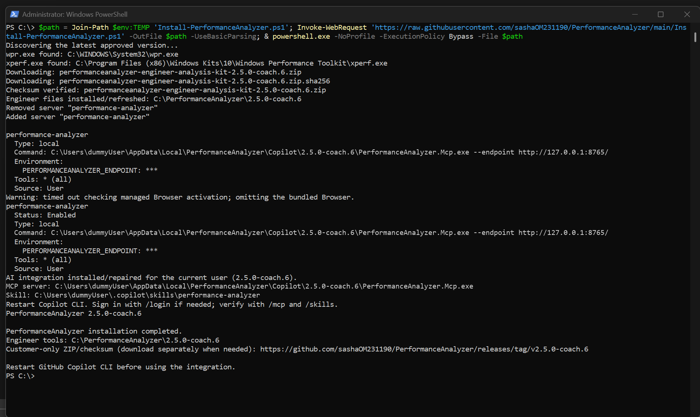

# PerformanceAnalyzer Coach

Capture and correlate Windows storage performance, Storport latency, PerfMon,
and minifilter activity. Coach guides disk/volume-specific analysis.

## Download / install

[Recommended: Coach 2.5.0-coach.6 packages](https://github.com/sashaOM231190/PerformanceAnalyzer/releases/tag/v2.5.0-coach.6)

| Package | Recipient |
| --- | --- |
| `performanceanalyzer-engineer-analysis-kit-2.5.0-coach.6.zip` | Engineer: analyzer, customer capture tools, MCP and skill |
| `performanceanalyzer-customer-capture-kit-2.5.0-coach.6.zip` | **Share this ZIP and its `.sha256` with the customer**; no analyzer or AI components |

**coach.6 is the rollback baseline and was repackaged:** ZIP checksums changed. Download
the new ZIP **and matching checksum** together. The old `start-capture.cmd`
was removed; use the explicit capture commands below.
For manual upgrades, extract into a clean directory: ZIP extraction does not
remove old launchers left by an earlier kit.
The analyzer retains the graph-loading correction and package-path adaptations;
MCP and skill use the original coach.6 payloads, not coach.7 binaries.
The integration script passes the endpoint explicitly. This rollback does not
claim to identify or fix the remaining machine-specific MCP failure.
Close coach.7/Coach sessions before installing; reopen the coach.6 executable
explicitly afterward. Older installed versions are not deleted.

Install/refresh the latest approved engineer kit (currently `2.5.0-coach.6`)
under `C:\PerformanceAnalyzer\<version>`.
The installer does not download or cache the separate customer ZIP and does
not create a `Packages` folder:

```powershell
$path = Join-Path $env:TEMP 'Install-PerformanceAnalyzer.ps1'; Invoke-WebRequest 'https://raw.githubusercontent.com/sashaOM231190/PerformanceAnalyzer/main/Install-PerformanceAnalyzer.ps1' -OutFile $path -UseBasicParsing; & powershell.exe -NoProfile -ExecutionPolicy Bypass -File $path
```

Without `-Version`, the installer reads `latest-version.txt` from this repository.
For future releases, update that file only after the release ZIP and matching
checksum are available. Add `-Version 2.5.0-coach.6` to pin a specific version.

The bootstrap reports `wpr.exe` and `xperf.exe` locations or missing-tool
warnings. It checks System32/Sysnative, PATH and standard Windows Performance
Toolkit folders; Xperf does **not** have to be in System32. Missing WPR
prevents minifilter capture; missing Xperf prevents ETL decoding, not BLG-only
analysis. Install missing tools through the
[Windows ADK / Windows Performance Toolkit](https://learn.microsoft.com/windows-hardware/get-started/adk-install).

If Copilot CLI is missing, integration asks before installing
`GitHub.Copilot` through WinGet. Installation/authentication may be restricted
by organizational policy. Bootstrap options:

```powershell
# Explicit consent to install missing Copilot CLI through WinGet.
powershell.exe -NoProfile -ExecutionPolicy Bypass -File $path -InstallCopilot
# Validate the engineer download/package only; do not install or change integration.
powershell.exe -NoProfile -ExecutionPolicy Bypass -File $path -ValidateOnly
# Install files without configuring AI integration.
powershell.exe -NoProfile -ExecutionPolicy Bypass -File $path -SkipCopilotIntegration
```

### Recognizing a successful installation

The screenshot below shows a completed installation of `2.5.0-coach.6`.
Your version, user profile, and installation paths may differ.
The username is replaced with `dummyUser` for privacy; use your own Windows user profile.



| Message | What it means |
| --- | --- |
| `wpr.exe found` / `xperf.exe found` | The recording and trace-analysis tools were located. |
| `Checksum verified` | The downloaded ZIP matches its published SHA-256 checksum. |
| `Engineer files installed/refreshed` | The engineer kit was copied to the displayed installation folder. |
| `AI integration installed/repaired for the current user` and server `Status: Enabled` | The Copilot integration was installed or refreshed and its MCP server was registered for this user. |
| `PerformanceAnalyzer installation completed.` | The installer finished successfully. |

The screenshot also shows a managed Browser activation timeout. In this example,
the bundled Browser was omitted and installation continued to completion.
Installation and server registration do not, by themselves, confirm end-to-end
Copilot connectivity.

**After installation:** restart GitHub Copilot CLI, sign in with `/login` if
needed, and check `/mcp` and `/skills` for the `performance-analyzer` server
and skill. The customer-only ZIP and checksum are downloaded separately when
needed for a customer capture.

## Installed directories

```text
C:\PerformanceAnalyzer\2.5.0-coach.6\
  readme.txt
  Analyzer\
    PerformanceAnalyzer.exe
    terminal_assets\
  CaptureKit\
    readme.txt
    capture_tools\
  Ai Integration\
    Integrate-Copilot.ps1
    Remove-CopilotIntegration.ps1
    Test-CopilotConnection.ps1
    version.txt
    copilot_mcp_server\
    copilot_skill\
```

Older installations may retain their old setup folders; the bootstrap refreshes
the new files without deleting unrelated files or saved captures.
An old `C:\PerformanceAnalyzer\Packages` cache is no longer used; you may
manually delete it after checking its contents. Download the customer ZIP
and checksum directly from the release page only when sharing with a customer.

## Capture: run as Administrator

Customer ZIP: extract to `C:\`; tools are directly under
`C:\PerformanceAnalyzer\2.5.0-coach.6\capture_tools`.
Engineer ZIP: tools are under `CaptureKit\capture_tools` instead.

```powershell
# Customer machine: capture the existing problem WITH minifilter callbacks.
Set-Location 'C:\PerformanceAnalyzer\2.5.0-coach.6\capture_tools'
powershell.exe -NoProfile -ExecutionPolicy Bypass -File .\Capture-StorageDiagnostics.ps1 -MiniFilter

# Engineer machine: use the capture tools included in the combined kit.
Set-Location 'C:\PerformanceAnalyzer\2.5.0-coach.6\CaptureKit\capture_tools'
powershell.exe -NoProfile -ExecutionPolicy Bypass -File .\Capture-StorageDiagnostics.ps1 -MiniFilter

# Different output location; minifilter callbacks still included.
powershell.exe -NoProfile -ExecutionPolicy Bypass -File .\Capture-StorageDiagnostics.ps1 -MiniFilter -OutputRoot 'D:\StorageTraces'

# Optional active DiskSpd baseline: obtain workload/write approval first.
powershell.exe -NoProfile -ExecutionPolicy Bypass -File .\Capture-StorageDiagnostics.ps1 -SetBaseline -MiniFilter
```

Reproduce after collectors start, press **Enter** to stop normal capture, and
wait for **Capture complete**. Baseline capture stops when DiskSpd finishes.
For minifilter capture, confirm nonempty `MiniFilter.etl` in the printed output
folder. Without `-MiniFilter`, missing minifilter data is expected.

Default output: `C:\PerfLogs\StorageCapture-*`. Archive the **entire stopped
capture folder**, including BLG, ETLs, mapping and manifest; transfer through
the approved support channel. Do not stop somebody else's WPR/kernel trace.
Captures can contain machine/process names and file paths.

[All capture parameters, mode combinations, DiskSpd flags and troubleshooting](documentation/Capture-Reference.md).
Cloning this repository does not include the capture tools; download a ZIP.

## Analyze

```powershell
& 'C:\PerformanceAnalyzer\2.5.0-coach.6\Analyzer\PerformanceAnalyzer.exe' 'C:\path\to\StorageCapture-folder'
& 'C:\PerformanceAnalyzer\2.5.0-coach.6\Analyzer\PerformanceAnalyzer.exe' /?
```

Coach starts with disk number and volume, then operation and interval.
Minifilter callback duration and Storport latency measure different boundaries;
do not subtract one from the other. Reorder graphs with the header Move handle
or Up/Down buttons.

## Install / repair AI integration

Run for the Windows account that will use Copilot; close running analyzer/Coach
sessions before replacing files:

```powershell
powershell.exe -NoProfile -ExecutionPolicy Bypass -File 'C:\PerformanceAnalyzer\2.5.0-coach.6\Ai Integration\Integrate-Copilot.ps1'
# Explicit WinGet consent if Copilot CLI is missing:
powershell.exe -NoProfile -ExecutionPolicy Bypass -File 'C:\PerformanceAnalyzer\2.5.0-coach.6\Ai Integration\Integrate-Copilot.ps1' -InstallCopilot
# Optional custom analyzer port:
powershell.exe -NoProfile -ExecutionPolicy Bypass -File 'C:\PerformanceAnalyzer\2.5.0-coach.6\Ai Integration\Integrate-Copilot.ps1' -Endpoint 'http://127.0.0.1:9000/'
copilot mcp get performance-analyzer
```

Restart Copilot CLI; sign in with `/login` if needed and verify `/mcp` and
`/skills`. The script refreshes only the PerformanceAnalyzer MCP registration
and skill. MCP binary: `%LOCALAPPDATA%\PerformanceAnalyzer\Copilot\2.5.0-coach.6`.
Skill: `%USERPROFILE%\.copilot\skills\performance-analyzer`.
If `COPILOT_HOME` is set, configuration and skills use that directory instead.
The registration passes the analyzer URL using `--endpoint`; an environment-only
registration from an earlier package can connect to MCP while querying the
wrong analyzer port. `get_server_status` reports MCP process readiness, not an
analyzer API health check.

If MCP connects but capture/Coach calls fail, keep the dashboard open and run
the read-only diagnostic as the same Windows user:

```powershell
$diagnostic = Join-Path $env:TEMP 'Test-CopilotConnection.ps1'
Invoke-WebRequest 'https://raw.githubusercontent.com/sashaOM231190/PerformanceAnalyzer/main/scripts/Test-CopilotConnection.ps1' -OutFile $diagnostic -UseBasicParsing
powershell.exe -NoProfile -ExecutionPolicy Bypass -File $diagnostic -Endpoint 'http://127.0.0.1:8765/'
```

Use the port actually shown in the browser. It checks the direct metadata API,
runs five read-only tools using the registered MCP command/environment and
prints MCP stderr so the underlying exception is not hidden. It does not alter
integration or captures, and does not print capture metadata or proxy values.
Review diagnostic output before sharing; exception messages can include local
paths. It does not reproduce environment changes made by a running Copilot CLI.

## Undo AI integration

Close analyzer/Coach and Copilot sessions. Run as the same Windows user that
installed the integration; Copilot CLI does not need to be installed:

```powershell
# Included in the engineer kit (not in customer capture_tools):
powershell.exe -NoProfile -ExecutionPolicy Bypass -File 'C:\PerformanceAnalyzer\2.5.0-coach.6\Ai Integration\Remove-CopilotIntegration.ps1' -WhatIf
powershell.exe -NoProfile -ExecutionPolicy Bypass -File 'C:\PerformanceAnalyzer\2.5.0-coach.6\Ai Integration\Remove-CopilotIntegration.ps1'

# Alternatively, download the standalone script:
$undo = Join-Path $env:TEMP 'Remove-CopilotIntegration.ps1'
Invoke-WebRequest 'https://raw.githubusercontent.com/sashaOM231190/PerformanceAnalyzer/main/scripts/Remove-CopilotIntegration.ps1' -OutFile $undo -UseBasicParsing
powershell.exe -NoProfile -ExecutionPolicy Bypass -File $undo -WhatIf
powershell.exe -NoProfile -ExecutionPolicy Bypass -File $undo
```

Removes only the `performance-analyzer` MCP registration, installed versioned
MCP binaries and skill, respecting `COPILOT_HOME`. Restart Copilot afterward.
It leaves Copilot CLI, unrelated integrations and captures intact.

**Optional manual cleanup:** save any captures, then delete
`C:\PerformanceAnalyzerKit` if that is where you extracted the kit.
The bootstrap installs under `C:\PerformanceAnalyzer` instead; check your
actual location first. The undo script does **not** delete either kit folder.

## Verify a ZIP

```powershell
$zip = 'C:\path\to\downloaded-package.zip'
$expected = [regex]::Match((Get-Content "$zip.sha256" -Raw), '(?i)\b[a-f0-9]{64}\b').Value
if (-not $expected -or (Get-FileHash $zip -Algorithm SHA256).Hash -ne $expected) { throw 'Checksum mismatch' }
```

Anonymous usage telemetry is enabled by default, not capture-content upload.
To disable it:

```powershell
& 'C:\PerformanceAnalyzer\2.5.0-coach.6\Analyzer\PerformanceAnalyzer.exe' --disable-telemetry
```

Restart the analyzer afterward. Packages remain public until a restricted
distribution location is established; removing links alone is not access control.
